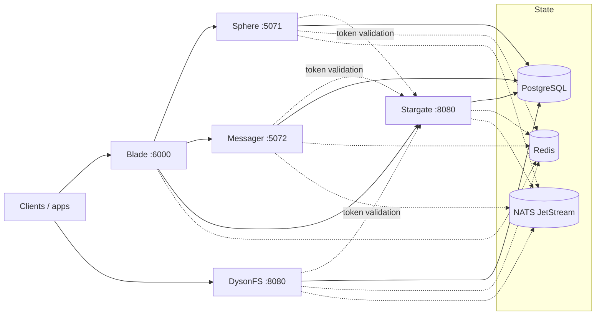

# Lighthouse

Lighthouse is the Go monorepo for the Solar Network service fleet. It contains
five services, an L4 relay and two web consoles, built from four Go modules
over one shared platform layer.

## Services

| Service | What it owns | HTTP | gRPC | Config |
|---|---|---|---|---|
| **Sphere** | Posts, publishers, timelines, categories/tags/collections, surveys, stickers, automod, the web reader, livestreams, ActivityPub federation | `:5071` | `:7099` | `config/sphere.toml` |
| **Messager** | Chat rooms, members, groups, messages, reactions, pins, voice clips, realtime calls | `:5072` | `:7100` | `config/messager.toml` |
| **Stargate** | Auth, accounts, OIDC, admin, E2EE/MLS, profiles, relationships, wallet | `:8080` | `:9090` | `internal/stargate/config.toml` |
| **Blade** | Reverse proxy, health checks, gRPC service discovery, websocket gateway | `:6000` | `:7001` | `internal/blade/configs/config.toml` |
| **DysonFS** | Uploads, media processing, previews, WebDAV/WOPI, S3 gateways | `:8080` | `:9090` | `internal/filesystem/config.toml` |

Blade also builds **`relay`**, an L4 node that routes TLS by SNI without
terminating it (`internal/blade/cmd/relay`, `:443`,
`internal/blade/configs/relay.toml`). The repo ships example configs for every
service except Blade, whose `configs/config.toml` is checked in.

Stargate and DysonFS use the same default ports; change one in its TOML when
both run on the same host. DysonFS runs in `master`, `worker` or `storage`
mode.

## Architecture



Sphere and Messager are separate processes with separate databases and module
sets; they share only `internal/platform`. Stargate is the identity service:
every authenticated fleet request is checked by `DyAuthService.Authenticate`
over gRPC, and no service validates JWTs locally. Blade fronts the HTTP and
websocket traffic and owns service discovery; relay nodes extend it by region.
DysonFS is the file service and can also run standalone against a synthesized
account.

PostgreSQL is required. Redis, NATS and every `[services]` target are optional:
a missing dependency degrades only the features that use it (sessions fall back
to memory, events stop, enrichment and notification lookups are skipped).

## Quick start

Prerequisites: Go 1.27, PostgreSQL, and Bun for the consoles. DysonFS media
processing expects libvips and ffmpeg at runtime. The Makefile runs DysonFS
with its pinned Go 1.26.2 toolchain automatically.

```sh
cp config/sphere.example.toml config/sphere.toml
cp config/messager.example.toml config/messager.toml
cp internal/stargate/config.example.toml internal/stargate/config.toml
cp internal/filesystem/config.example.toml internal/filesystem/config.toml

make build

# Start Stargate first: the other services authenticate through it.
make run-stargate STARGATE_CONFIG=config.toml
make run-blade
make run-sphere SPHERE_CONFIG=config/sphere.toml
make run-messager MESSAGER_CONFIG=config/messager.toml
make run-filesystem FILESYSTEM_CONFIG=config.toml
```

Run each service in its own terminal. The `run-*` targets default to the
checked-in example configs; the `*_CONFIG` variables above point them at your
copies. The example DSNs expect the databases `dyson_sphere`, `dyson_messager`,
`dyson_stargate` and `dyson_drive`; create them or edit the DSNs. DysonFS can
also run without an auth service by setting `[auth] target = ""`.

Sphere, Messager, Stargate and DysonFS expose `/health`, `/alive` and
`/api/modules`; Blade serves `/health` and `/health/:service`. Blade's gateway
is optional when calling a service directly.

## Layout

```text
go.work                 workspace: ., internal/stargate, internal/blade
cmd/                    sphere and messager processes and legacy importers
config/                 example Sphere/Messager configs
internal/platform/      shared bootstrap, config, DB, Redis, NATS, auth, HTTP/gRPC
internal/sphere/        Sphere service: config, core, models, store, ports, modules
internal/messager/      Messager service, same shape
internal/stargate/      identity service, console, migration commands
internal/blade/         gateway, relay, discovery, websocket gateway
internal/filesystem/    DysonFS, console, migration and repair commands
docs/                   module contract and implementation status
DEPLOYMENT.md           deployment, data migration and cutover runbook
NOTES.md                original README and porting notes
```

### Workspace

`go.work` uses the root, Stargate and Blade modules so one checkout builds and
tests them with Go 1.27. Each service keeps its own `go.mod` and `go.sum`; a
child's location under `internal/` is only a directory choice, and imports go
through its module path.

Two consequences:

- Directory patterns stop at a nested `go.mod`, so `go build ./...` at the root
  covers only Sphere and Messager. Use the Makefile, or build a child module
  explicitly.
- Docker images build with the child directory as context
  (`./internal/stargate`, `./internal/blade`, `./internal/filesystem`), so
  `go.work` never enters an image and each child stays buildable on its own.

`internal/filesystem` is deliberately **not** in `go.work`: it pins Go 1.26.2,
and under Go 1.27 its `golang.org/x/net` and gRPC versions do not compile
together. The root Makefile and `internal/filesystem/Makefile` run it with
`GOWORK=off GOTOOLCHAIN=go1.26.2`; drop that override once the dependency pair
is upgraded.

## Modules

Sphere, Messager, Stargate and DysonFS use the same compile-time, Caddy-style
registry: a `module.Factory[C]` carries the module ID, dependencies, ports,
GORM models, schema hooks and capabilities; `Configure` mounts its HTTP routes
and gRPC services. `[modules]` in the TOML selects what runs:

```toml
[modules]
enabled = []                     # empty = every module whose default is on
disabled = ["app.solian.sphere.fediverse"]
```

Disabling a module unmounts its surface and, on a fresh database, prevents its
tables from being created. Existing tables are never dropped. Re-enabling a
module reuses its data. `GET /api/modules` reports the resolved set and
capabilities.

The authoring contract is [`docs/MODULE_CONTRACT.md`](docs/MODULE_CONTRACT.md).
Per-service inventories live in
[`internal/stargate/docs/module-system-plan.md`](internal/stargate/docs/module-system-plan.md)
and [`internal/filesystem/docs/module-system.md`](internal/filesystem/docs/module-system.md).

## Development

```sh
make test          # per-module Go test suites
make lint          # go vet for every module
make fmt
make tidy

make web-stargate       # build the Stargate console
make web-stargate-dev   # Vite on :5173, proxying /api to :8080
make web-filesystem     # build the DysonFS console
make web-filesystem-dev
```

Stargate's `internal/store` tests need a reachable PostgreSQL. DysonFS's suite
needs libvips and ffmpeg and carries two known failures listed in the Makefile.

## Deploy

- `Dockerfile.sphere` and `Dockerfile.messager` build the root-module services
  from context `.` into static `scratch` images.
- `internal/stargate/Dockerfile` builds the console and the service; context
  `./internal/stargate`.
- `internal/blade/Dockerfile` builds both Blade binaries into one image;
  context `./internal/blade`. The gateway is the default process, and `relay`
  as the container command runs the L4 node.
- `internal/filesystem/Dockerfile` builds the console and DysonFS; context
  `./internal/filesystem`, keeping libvips and ffmpeg in the runtime.
- `internal/blade/docker-compose.yml` runs the gateway with its Redis registry;
  `internal/blade/docker-compose.relay.yml` runs a PoP relay.
- CI (`.github/workflows/{sphere,messager,stargate,blade,filesystem}.yml`)
  builds and pushes the five service images — `lighthouse-sphere`,
  `lighthouse-messager`, `lighthouse-stargate`, `lighthouse-blade`,
  `lighthouse-dysonfs` — path-filtered on its sources. The `lighthouse-` prefix
  keeps them off the package names the legacy fleet still publishes to.
  `.github/workflows/images.yml` rebuilds all five on manual
  dispatch — use it after base-image or toolchain bumps, or to verify a change
  that touches shared inputs; `latest` only moves from `master`.

Deployment, the legacy-data migration and the cutover runbook are in
[`DEPLOYMENT.md`](DEPLOYMENT.md). Helpers: `make migrate-sphere`,
`make migrate-messager`, `make migrate-stargate`,
`make migrate-filesystem-legacy`.

## API conventions

- JSON bodies are snake_case, enums are integers and times are UTC RFC3339.
- Errors use the shared `ApiError` envelope (`code`, `message`, `status`,
  `detail`, `traceId`, `errors`, `meta`).
- List endpoints return a bare array and put the total in `X-Total`.
- Inbound tokens are validated by Stargate over gRPC.
- Outbound events keep the JetStream subjects and the `websocket_push`
  envelope Blade's gateway consumes.

## Documentation

| Document | Contents |
|---|---|
| [`DEPLOYMENT.md`](DEPLOYMENT.md) | deployment, migration, cutover and runtime differences |
| [`docs/PORT_STATUS.md`](docs/PORT_STATUS.md) | verified behavior and known implementation gaps |
| [`docs/MODULE_CONTRACT.md`](docs/MODULE_CONTRACT.md) | module authoring contract |
| [`NOTES.md`](NOTES.md) | original README, legacy import details and porting notes |
| [`internal/stargate/README.md`](internal/stargate/README.md) | Stargate modules, auth flows and console |
| [`internal/blade/README.md`](internal/blade/README.md) | gateway configuration, discovery and maintenance mode |
| [`internal/filesystem/README.md`](internal/filesystem/README.md) | DysonFS modes, upload API and media pipeline |
