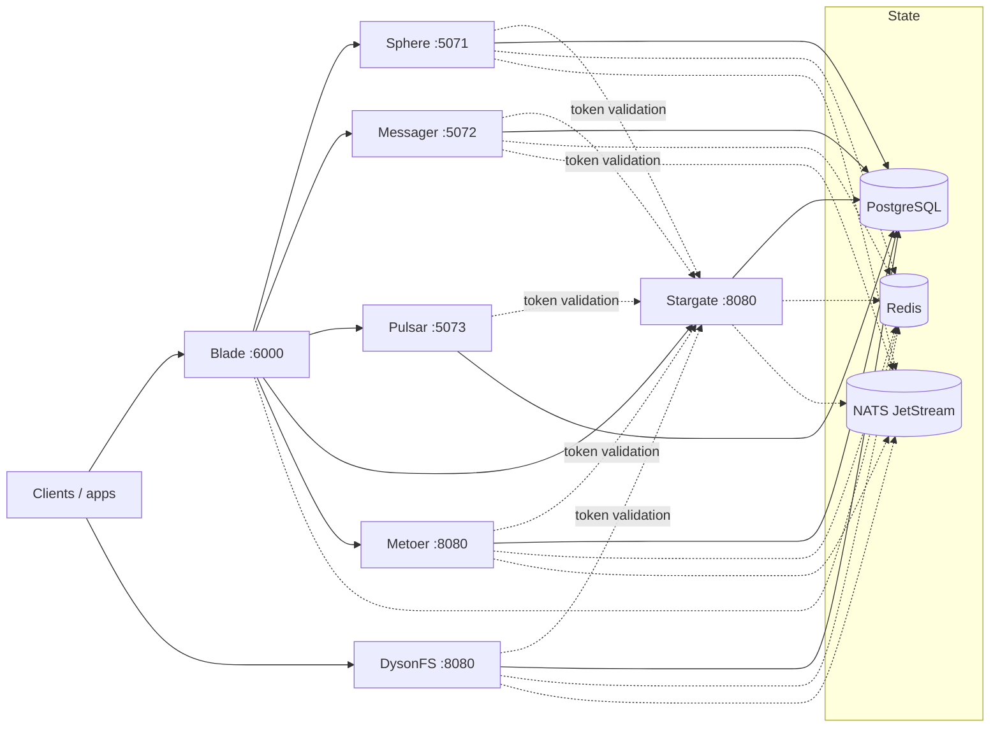

# Lighthouse

Lighthouse is the Go monorepo for the Solar Network service fleet. It contains
six services, an L4 relay and two web consoles, built from five Go modules
over one shared platform layer.

## Services

| Service | What it owns | HTTP | gRPC | Config |
|---|---|---|---|---|
| **Sphere** | Posts, publishers, timelines, categories/tags/collections, surveys, stickers, automod, the web reader, livestreams, ActivityPub federation | `:5071` | `:7099` | `internal/sphere/config.toml` |
| **Messager** | Chat rooms, members, groups, messages, reactions, pins, voice clips, realtime calls | `:5072` | `:7100` | `internal/messager/config.toml` |
| **Pulsar** | Multi-domain playback tracking, now-playing sessions, scrobbling, multi-media catalog, playlists & collections, rewind stats, and the per-account library mirror GroovyBox syncs | `:5073` | `:7101` | `internal/pulsar/config.toml` |
| **Stargate** | Auth, accounts, OIDC, admin, E2EE/MLS, profiles, relationships, wallet | `:8080` | `:9090` | `internal/stargate/config.toml` |
| **Metoer** | Notifications, push delivery (FCM/APNs/UnifiedPush/SOP), email sending plans and delivery observability | `:8080` | `:9090` | `internal/metoer/config.toml` |
| **Blade** | Reverse proxy, health checks, gRPC service discovery, websocket gateway | `:6000` | `:7001` | `internal/blade/configs/config.toml` |
| **DysonFS** | Uploads, media processing, previews, WebDAV/WOPI, S3 gateways | `:8080` | `:9090` | `internal/filesystem/config.toml` |

Blade also builds **`relay`**, an L4 node that routes TLS by SNI without
terminating it (`internal/blade/cmd/relay`, `:443`,
`internal/blade/configs/relay.toml`). The repo ships example configs for every
service except Blade, whose `configs/config.toml` is checked in.

Stargate, Metoer and DysonFS ship the same default ports; change one in its
TOML when they run on the same host. DysonFS runs in `master`, `worker` or
`storage` mode.

## Architecture



Sphere and Messager are separate processes with separate databases and module
sets; they share only the vendored `shared` module (platform layer plus SDK).
Stargate is the identity service:
every authenticated fleet request is checked by `DyAuthService.Authenticate`
over gRPC, and no service validates JWTs locally. Metoer replaces
DysonNetwork.Ring: notifications, push delivery, email plans and delivery
observability, with the same token and permission checks. Blade fronts the
HTTP and websocket traffic and owns service discovery; relay nodes extend it
by region. DysonFS is the file service and can also run standalone against a
synthesized account.

PostgreSQL is required. Redis, NATS and every `[services]` target are optional:
a missing dependency degrades only the features that use it (sessions fall back
to memory, events stop, enrichment and notification lookups are skipped).

## Quick start

Prerequisites: Go 1.27, PostgreSQL, and Bun for the consoles. DysonFS media
processing expects libvips and ffmpeg at runtime. The Makefile runs DysonFS
with its pinned Go 1.26.2 toolchain automatically.

```sh
cp internal/sphere/config.example.toml internal/sphere/config.toml
cp internal/messager/config.example.toml internal/messager/config.toml
cp internal/stargate/config.example.toml internal/stargate/config.toml
cp internal/metoer/config.example.toml internal/metoer/config.toml
cp internal/filesystem/config.example.toml internal/filesystem/config.toml

make build

# Start Stargate first: the other services authenticate through it.
make run-stargate STARGATE_CONFIG=internal/stargate/config.toml
make run-blade
make run-sphere SPHERE_CONFIG=internal/sphere/config.toml
make run-messager MESSAGER_CONFIG=internal/messager/config.toml
make run-metoer METOER_CONFIG=internal/metoer/config.toml
make run-filesystem FILESYSTEM_CONFIG=internal/filesystem/config.toml
```

Run each service in its own terminal. The `run-*` targets default to the
checked-in example configs; the `*_CONFIG` variables above point them at your
copies. The example DSNs expect the databases `dyson_sphere`, `dyson_messager`,
`dyson_pulsar`, `dyson_stargate`, `dyson_ring` and
`dyson_drive`; create them or edit the DSNs.
DysonFS can also run without an auth service by setting `[auth] target = ""`.

Sphere, Messager, Pulsar, Stargate, Metoer and DysonFS expose
`/health`, `/alive` and `/api/modules`; Blade serves `/health` and
`/health/:service`. Blade's gateway is optional when calling a service
directly.

## Layout

Every service owns one directory under `internal/`, and that directory is
either a package of the root module or a module of its own (see
[Workspace](#workspace)).

```text
go.work                 workspace: ., shared, internal/stargate, internal/blade, internal/metoer
shared/                 vendored fleet SDK: auth, cache, errs, eventbus, models, proto
shared/platform/        house platform layer: bootstrap, config, DB, Redis, NATS, HTTP/gRPC
internal/sphere/        Sphere module: cmd/, config, core, models, store, ports, modules
internal/messager/      Messager module, same shape
internal/pulsar/        Pulsar module: cmd/, config, core, models, store, modules
internal/stargate/      Stargate module: cmd/, console, migration commands, packages
internal/metoer/        Metoer module: cmd/, config, store, push, email, scheduler
internal/blade/         Blade module: cmd/, gateway, relay, discovery, websocket gateway
internal/filesystem/    DysonFS module: cmd/, console, migration and repair commands
docs/                   module contract and implementation status
DEPLOYMENT.md           deployment, data migration and cutover runbook
NOTES.md                original README and porting notes
```

### Workspace

`go.work` uses the root, `shared`, Stargate, Blade and Metoer modules so one
checkout builds and tests them with Go 1.27. Each service keeps its own
`go.mod` and `go.sum`; a service's directory under `internal/` is only a
directory choice, and imports go through its module path. The shared module
lives at `shared/` (module `src.solsynth.dev/sosys/lighthouse/shared`) and is
also published from this repository under `shared/vX.Y.Z` tags. `go.work`
points at the local copy for workspace builds; each service's `go.mod` requires
a tag, so Docker and CI fetch it from git instead of a local `replace`.

Two consequences:

- Directory patterns stop at a nested `go.mod`, so `go build ./...` at the root
  covers only Sphere and Messager. Use the Makefile, or build a child module
  explicitly.
- Docker images build with the service directory as context
  (`./internal/stargate`, `./internal/metoer`, `./internal/blade`,
  `./internal/filesystem`), so `go.work` never enters an image. Their `go.mod`
  pins a `shared/vX.Y.Z` tag and fetches it from git.

`internal/filesystem` is deliberately **not** in `go.work`: it pins Go 1.26.2,
and under Go 1.27 its `golang.org/x/net` and gRPC versions do not compile
together. The root Makefile and `internal/filesystem/Makefile` run it with
`GOWORK=off GOTOOLCHAIN=go1.26.2`; drop that override once the dependency pair
is upgraded.

## Modules

Sphere, Messager and Stargate use the same compile-time, Caddy-style registry
from `shared/platform/module`: a `module.Factory[C]` carries the module ID,
dependencies, ports, GORM models, schema hooks and capabilities; `Configure`
mounts its HTTP routes and gRPC services. DysonFS keeps its own registry shape.
`[modules]` in the TOML selects what runs:

```toml
[modules]
enabled = []                     # empty = every module whose default is on
disabled = ["app.solian.sphere.fediverse"]
```

Disabling a module unmounts its surface and, on a fresh database, prevents its
tables from being created. Existing tables are never dropped. Re-enabling a
module reuses its data. `GET /api/modules` reports the resolved set and
capabilities.

The authoring contract is [`docs/MODULE_CONTRACT.md`](docs/MODULE_CONTRACT.md).
Per-service inventories live in
[`internal/stargate/docs/module-system-plan.md`](internal/stargate/docs/module-system-plan.md)
and [`internal/filesystem/docs/module-system.md`](internal/filesystem/docs/module-system.md).

## Development

```sh
make test          # per-module Go test suites
make lint          # go vet for every module
make fmt
make tidy

make web-stargate       # build the Stargate console
make web-stargate-dev   # Vite on :5173, proxying /api to :8080
make web-filesystem     # build the DysonFS console
make web-filesystem-dev
```

Stargate's `store` tests need a reachable PostgreSQL. DysonFS's suite needs
libvips and ffmpeg and carries two known failures listed in the Makefile.

## Deploy

- `Dockerfile.sphere`, `Dockerfile.messager` and `Dockerfile.pulsar` build the
  root-module services from context `.` into static `scratch` images.
- `internal/stargate/Dockerfile` builds the console and the service; context
  `./internal/stargate`.
- `internal/metoer/Dockerfile` builds Metoer; context `./internal/metoer`.
- `internal/blade/Dockerfile` builds both Blade binaries into one image;
  context `./internal/blade`. The gateway is the default process, and `relay`
  as the container command runs the L4 node.
- `internal/filesystem/Dockerfile` builds the console and DysonFS; context
  `./internal/filesystem`, keeping libvips and ffmpeg in the runtime.
- `internal/blade/docker-compose.yml` runs the gateway with its Redis registry;
  `internal/blade/docker-compose.relay.yml` runs a PoP relay.
- CI (`.github/workflows/{sphere,messager,stargate,metoer,blade,filesystem}.yml`)
  builds and pushes the six path-filtered service images — `lighthouse-sphere`,
  `lighthouse-messager`, `lighthouse-stargate`, `lighthouse-metoer`,
  `lighthouse-blade`, `lighthouse-dysonfs`. The
  `lighthouse-` prefix keeps them off the package names the legacy fleet still
  publishes to. `.github/workflows/images.yml` rebuilds all six on manual
  dispatch — use it after base-image or toolchain bumps, or to verify a change
  that touches shared inputs; `latest` only moves from `master`.

Deployment, the legacy-data migration and the cutover runbook are in
[`DEPLOYMENT.md`](DEPLOYMENT.md). Helpers: `make migrate-sphere`,
`make migrate-messager`, `make migrate-stargate`,
`make migrate-filesystem-legacy`.

## API conventions

- JSON bodies are snake_case, enums are integers and times are UTC RFC3339.
- Errors use the shared `ApiError` envelope (`code`, `message`, `status`,
  `detail`, `traceId`, `errors`, `meta`).
- List endpoints return a bare array and put the total in `X-Total`.
- Inbound tokens are validated by Stargate over gRPC.
- Outbound events keep the JetStream subjects and the `websocket_push`
  envelope Blade's gateway consumes.

## Documentation

| Document | Contents |
|---|---|
| [`DEPLOYMENT.md`](DEPLOYMENT.md) | deployment, migration, cutover and runtime differences |
| [`docs/PORT_STATUS.md`](docs/PORT_STATUS.md) | verified behavior and known implementation gaps |
| [`docs/MODULE_CONTRACT.md`](docs/MODULE_CONTRACT.md) | module authoring contract |
| [`NOTES.md`](NOTES.md) | original README, legacy import details and porting notes |
| [`internal/stargate/README.md`](internal/stargate/README.md) | Stargate modules, auth flows and console |
| [`internal/metoer/README.md`](internal/metoer/README.md) | Metoer push/email pipeline, cutover and compatibility notes |
| [`internal/blade/README.md`](internal/blade/README.md) | gateway configuration, discovery and maintenance mode |
| [`internal/filesystem/README.md`](internal/filesystem/README.md) | DysonFS modes, upload API and media pipeline |
